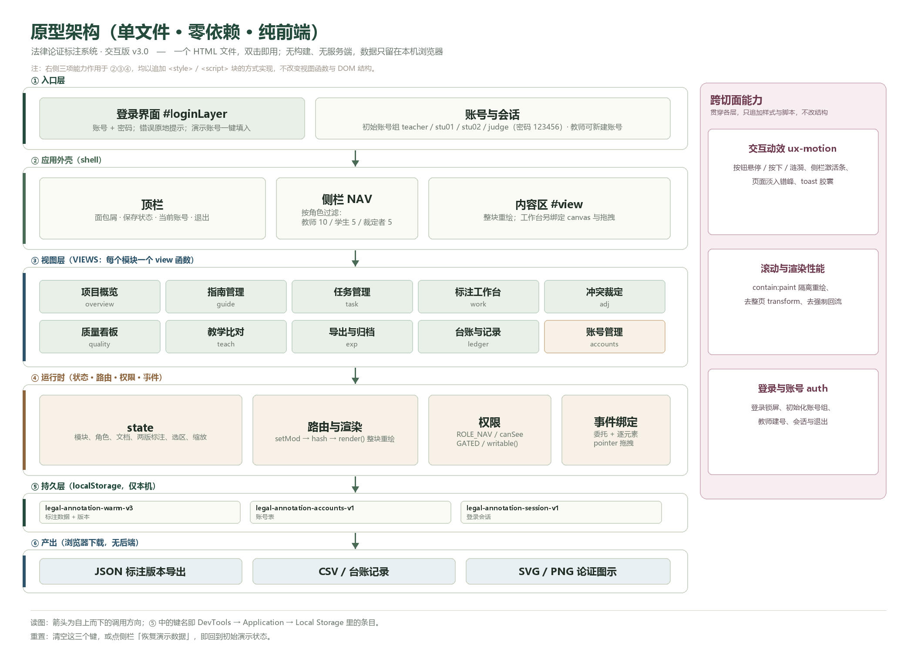

# 法律论证标注系统 · 交互式原型 v3.0

**在线演示**：<https://zzq4546-arch.github.io/legal-annotation-system/法律论证标注系统-原型-交互版.html>
演示账号 `teacher` / `stu01` / `stu02` / `judge`，密码均为 `123456`。

> 一个 HTML 文件就能跑的**裁判文书论证结构标注**教学原型：把"裁判理由"切成命题、贴上论证标签、连成关系图，再由教师/裁定者核对、比对、导出。

| 项目 | 说明 |
|---|---|
| 形态 | 单文件 HTML（约 342 KB），零依赖、零构建 |
| 运行 | 双击打开，或本地静态服务器 |
| 后端 | 无。所有数据存在浏览器 localStorage |
| 模块 | 10 个（9 个业务模块 + 1 个账号管理） |
| 演示数据 | (2023)苏0106民初18909号，裁判理由 244 字，13 个命题、10 条关系 |

---

## 1. 怎么运行

**方式 A：双击（推荐）**

直接双击 `法律论证标注系统-原型-交互版.html`，用 Chrome / Edge 打开即可。

**方式 B：本地静态服务器**（想用 `http://` 地址或做投屏演示时）

```bash
# 在本文件夹打开终端
python -m http.server 8080
# 浏览器访问 http://127.0.0.1:8080/法律论证标注系统-原型-交互版.html
```

**方式 C**：把 HTML 文件直接拖进浏览器窗口。

> 说明：页面**不发任何网络请求**，`file://` 下功能完整。首次打开会停在登录页。

**浏览器要求**：Chrome / Edge 100+、Firefox 100+、Safari 15+（用到 `contain`、`requestAnimationFrame`、`localStorage`）。

---

## 2. 演示账号

| 姓名 | 账号 | 密码 | 角色 |
|---|---|---|---|
| 王老师 | `teacher` | `123456` | 教师 |
| 学生甲 | `stu01` | `123456` | 学生 |
| 学生乙 | `stu02` | `123456` | 学生 |
| 赵博士 | `judge` | `123456` | 裁定者 |

- 登录页下方有账号组提示，点击可一键填入。
- 教师登录后可在「账号管理」里给学生/裁定者**新建账号**（学生不能自建）。
- 退出登录在右上角。

---

## 3. 角色与可见模块

同一个原型，三种身份看到的是**不同的工作台**：

| 模块 | 教师 | 学生 | 裁定者 |
|---|:--:|:--:|:--:|
| 项目概览 overview | ✓ | ✓ | ✓ |
| 指南管理 guide | ✓ | ✓ | — |
| 任务管理 task | ✓ | — | — |
| 标注工作台 work | ✓ | ✓ | ✓ |
| 冲突裁定 adj | ✓ | — | ✓ |
| 质量看板 quality | ✓ | — | ✓ |
| 教学比对 teach | ✓ | ✓ | — |
| 导出与归档 exp | ✓ | — | — |
| 台账与记录 ledger | ✓ | ✓ | ✓ |
| 账号管理 accounts | ✓ | — | — |

**落地页**：教师 → 项目概览；学生 → 教学比对；裁定者 → 冲突裁定。

权限是**前端强制**的：`ROLE_NAV` 决定侧栏显示哪些项，直接改 hash 越权访问会被拦回落地页；学生写标注只能写到「练习版」，不污染正式版本。

---

## 4. 模块说明

### ① 项目概览 `overview`
工作台首页。四张指标卡（命题要素 / 论证关系 / 待复核分歧 / 指南版本）+ 进行中的任务卡 + 右侧"一步一步，建立理解"的流程提示。顶部有当前角色横幅与快捷入口。

### ② 指南管理 `guide`
管理**标注指南与标签体系**：12 个命题标签代码（SF / GF / SM / GM 及 GM 的 5 个子类 / SM-C / IS / Non）、5 种关系类型（S 支持 / A 反对 / J 组合 / M 匹配 / I 同一）、颗粒度切分规则。指南按版本冻结，任务创建时绑定版本号。

### ③ 任务管理 `task`
创建标注任务：**文本导入与范围定位**（系统按"本院认为"到"判决如下"定位裁判理由，可手工微调 char 起止）→ **案例信息**（案号、法院、层级、审级、案由、案件性质、裁判日期）→ **分配标注员**（≥2 人独立标注）与裁定者。

### ④ 标注工作台 `work`
核心页面，三栏布局：

- **左栏**：裁判理由原文，按句/逗号切分，可调整颗粒度边界；
- **中栏**：命题清单，逐个贴标签（一级/二级）；
- **右栏**：论证关系图（SVG），点击两个节点建立关系，可拖拽节点、缩放画布。

图示遵循规范：命题是只写序号的矩形，实心圆=支持、空心圆=反对、带"+"圆=组合/匹配、框内"/"=同一。

### ⑤ 冲突裁定 `adj`
并排展示两位标注员的版本，逐条列出差异项（标签不一致 / 关系缺失或方向不同），裁定者选择"采纳张三 / 采纳李四 / 重标"并填写理由（可引用指南条目），确认后写入最终版本。**系统不自动判定谁对**，只呈现差异。

### ⑥ 质量看板 `quality`
按指南 8.3 计算一致性：**颗粒度差异率**（>10% 标记为需退回重切）、**标签一致率**，并列出两版在同一对象上标签不同的高冲突项。

### ⑦ 教学比对 `teach`
教学闭环（UC-05 / UC-08）：① 教师发布标准样例 → ② 学生独立标注 → ③ 与标准结果比对。学生的改动只写进练习数据，不污染正式标注库。

### ⑧ 导出与归档 `exp`
UC-15 结果输出：**JSON**（字符索引 + 标签层级 + 关系定义，可直接喂模型）、**CSV**（命题列表 + 关系）、**SVG**（论证图示）、**Markdown**（标注报告）。导出包内写入指南版本号；导出后数据只读。

### ⑨ 台账与记录 `ledger`
疑难问题台账（时间 / 类型 / 分歧 / 结论）+ 一致性指标明细 + 当前版本的数据规模，用于追溯"当时为什么这么定"。

### ⑩ 账号管理 `accounts`（本次新增）
教师专用：填写姓名、账号、初始密码、角色即可建号；下方列出全部账号与创建时间。账号存在独立的 localStorage 键里，**「恢复演示数据」不会清掉账号**。

---

## 5. 架构



自上而下六层，右侧是三项跨切面能力：

| 层 | 内容 |
|---|---|
| ① 入口层 | 登录锁屏 `#loginLayer`、账号与会话 |
| ② 应用外壳 | 顶栏（面包屑/保存状态/账号/退出）、侧栏 NAV、内容区 `#view` |
| ③ 视图层 | `VIEWS` 里每个模块一个 `view*()` 函数，返回 HTML 字符串 |
| ④ 运行时 | `state` 全局状态、`setMod → hash → render()` 整块重绘、权限判定、事件绑定 |
| ⑤ 持久层 | localStorage 三个键 |
| ⑥ 产出 | JSON / CSV / SVG / PNG 下载 |

**跨切面**（只追加 `<style>` / `<script>`，不改视图函数与 DOM）：

- `ux-motion`：按钮悬停/按下/涟漪、侧栏激活条、页面淡入错峰、toast 胶囊；
- `perf-scroll`：`contain: paint` 隔离重绘、去掉整页 transform、去掉强制回流；
- `auth`：登录、初始账号组、建号、会话与退出。

**渲染模型**：没有虚拟 DOM，`render()` 直接 `#view.innerHTML = VIEWS[mod]()` 整块重绘；工作台渲染后再单独 `paintSource / paintList / paintOps / paintSvg` 并绑定交互。

---

## 6. 数据与存储

数据全在浏览器里，三个键（DevTools → Application → Local Storage）：

| 键 | 内容 |
|---|---|
| `legal-annotation-warm-v3` | 标注数据（文档、两版标注、关系、台账、指南版本…） |
| `legal-annotation-accounts-v1` | 账号表 |
| `legal-annotation-session-v1` | 登录会话 |

**重置**：清空这三个键，或点侧栏「恢复演示数据」，即回到初始演示状态。

**注意**：换浏览器、换电脑、清缓存都会丢数据；要留存请用「导出与归档」下载 JSON。

---

## 7. 快捷键

| 按键 | 作用 |
|---|---|
| `↑` / `↓` | 焦点在侧栏时，在模块间上下切换 |
| `Enter` | 登录页直接提交 |

---

## 8. 技术实现

单文件内按块组织，追加的样式/脚本都带 id，便于定位与回退：

```
<style>                       基础样式（布局、卡片、表格、对话框）
<style id="perf-scroll-v1">   滚动与重绘优化
<style id="ux-motion-v1">     交互动效
<script id="ux-motion-js">    涟漪、高光、保存圆点脉冲
<script id="role-shell-js">   角色化导航与权限
<style id="auth-css">         登录层样式
<script id="auth-js">         登录、账号、会话、账号管理模块
```

- **无框架**：原生 JS，ES5 风格函数 + 模板字符串；
- **动效只用 `transform` / `opacity` / `box-shadow`**，走合成层，不触发重排；
- 尊重系统设置：`@media (prefers-reduced-motion: reduce)` 下动效自动降级；
- 滚动容器加 `contain: paint`，避免整页重绘。

---

## 9. 已知限制

这是**教学演示原型**，不是生产系统：

1. **单机单用户**：没有服务端，多人无法真正协作，多"账号"只是本地数据分区；
2. **密码明文**存在 localStorage，仅用于演示登录流程；
3. **文本导入**是演示级的：PDF/Word 不做真实解析，按"本院认为…判决如下"规则模拟定位，需人工校正边界；
4. 数据规模按**单文档、单任务**设计，未做分页与增量渲染；
5. 刷新后依赖 localStorage，清缓存即丢失（请先导出）。

生产化路径（后端、数据库、并发、鉴权、审计）见 `系统开发交接文档.md`。

---

## 10. 配套文档

| 文档 | 内容 |
|---|---|
| `裁判文书论证结构标注系统-需求梳理与全流程实例.docx` | 需求来源、业务规则、端到端实例 |
| `法律论证标注系统-系统用例图与用例描述.docx` | 用例图 + 3 张用例描述表 |
| `法律论证标注系统-顺序图集-含激活条.docx` | 三张 UML 顺序图 |
| `角色与页面差异说明.md` | 角色权限矩阵与实现方式 |
| `登录与账号说明.md` | 登录流程、账号规则、会话处理 |
| `交互动效说明.md` | 每个动效的参数与演示脚本 |
| `系统开发交接文档.md` | 领域模型、接口、架构、里程碑（给正式开发用） |
| `法律论证模型教学辅助模块-自然语言描述与ERD.docx` | 数据库设计（20 实体、6 张 ERD） |

> 另有一份 `原型使用说明.md`，对应的是**上一代 v2.0 原型**（`法律论证标注系统-原型.html`，9 个模块、无登录）。两份原型并存：v2.0 留作对照，日常演示请用本文档对应的**交互版 v3.0**。

