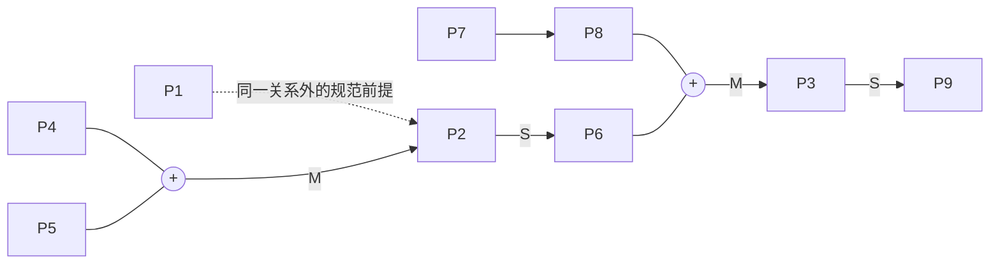
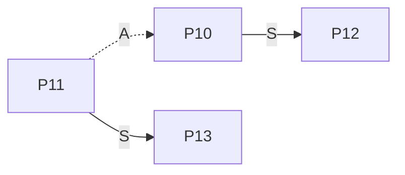

# 裁判文书论证结构标注系统：文件解读、需求梳理与全流程实例

> 分析对象
> 1. `裁判文书标记需求_按阶段组织.docx`（v1.1，2026-04-14，状态：待确认）——**系统需求文档**，即"要建什么软件"。
> 2. `v1.2 中文裁判文书说理部分法律论证结构标注与图示指南.pdf`（26 页，摘要页标注 v1.1）——**标注规范文档**，即"标注业务规则"。
>
> 本文件由两份原始材料交叉比对后整理：需求文档回答"系统要提供哪些功能"，指南回答"标注到底怎么标"。两者是**业务规范**与**软件实现**的关系，指南是需求的业务前提，需求文档是把指南落成产品的工程描述。

---

## 一、这两份文件是什么、用来干什么

### 1.1 一句话定位

| 文件 | 性质 | 读者 | 作用 |
|---|---|---|---|
| PDF《标注与图示指南》 | 学术/业务规范（方法论标准） | 标注员、裁定者、法学研究者、AI 研究人员 | 定义"裁判说理"如何被切分、如何打标签、如何连关系、如何画图，保证不同人标出来的数据可比、可复现 |
| DOCX《标记需求》 | 软件需求说明书（按用例阶段组织） | 产品/开发/测试、项目负责人 | 把上面的规范落成一套 Web 协作系统：上传文书 → 配置标签 → 多人独立标注 → 冲突裁定 → 导出数据集与图示 |

### 1.2 指南（PDF）到底规定了一套什么体系

它的目标是：**把裁判文书"本院认为"部分里隐含的推理过程，变成可观察、可分析、可计算的结构化数据**（要素 + 关系 + 图示），服务于法学教育、法学实证研究、裁判说理规范化评估、法律 AI（论证挖掘/评估/生成）。

核心内容分六块：

1. **标注对象与范围**：中国裁判文书网的原始判决书、人民法院案例库的指导性案例与参考案例；**只标"裁判理由"部分** = 正文中"本院认为"之后到"判决如下"所在句子之前的文本。案号、法院、案由等另作"案例信息标注"，不进入论证结构。
2. **颗粒度规则**：先按**句号**切第一刀；句号内再按**逗号/分号**考察子句——连续子句若性质相同且无支持/反对关系，**合并为一个要素**；否则各自独立编号；带双引号的以双引号为单位；**过渡语词（"理由如下：""因此，""综上来看，"）与后面第一个要素切在一起**。
3. **要素类型体系**：两个维度（个别/一般 × 事实/规范）→ 四种基础判断：
   - **SF 个别事实判断**（案件中的具体事实，如"原告已依约提供劳务"）
   - **GF 一般事实判断**（经验法则、行业知识、社会常识）
   - **SM 个别规范判断**（法院或主体作出的有法律意义的评价判断；"应/应当"是典型标志）
   - **GM 一般规范判断**（规范基础），再分五种子类型：**GM-L 法律条文 / GM-I 法律解释 / GM-U 习惯与行业惯例 / GM-M 道德与价值观念 / GM-O 其他**
   - 另设 **SM-C 合同及合同解释**（个别规范判断的特殊类型）
   - 非命题要素：**IS 争议焦点**（小标题、争议概括）、**Non 非论证成分**（与论证无关的信息）
   - 子类型标注三原则：**优先匹配**（能归 GM-L~GM-M 就不用 GM-O）、**不重复标注**、**以文本显性表达为准**（不靠背景知识补充规范来源）
4. **关系类型体系**（五种）：**S 支持 / A 反对 / J 组合（合取，"缺一不可"）/ M 匹配（个别判断 ↔ 一般判断的对应）/ I 同一（语义重复）**；并给出十种"有嵌套"形式（如 `M(J(p1,p2),p3)`、`S(M(J(p1,p2,p3),p4),p5)`、`A(p3,S(p1,p2))`）。
5. **图示规范**：命题=矩形（框内只写序号，**不显示命题类型**），关系=圆形节点。**实心圆●=支持，空心圆○=反对，带"+"圆=组合或匹配，矩形框内"/"=同一**；嵌套结构要求**自内而外逐层构造**，保持括号层级与逻辑层级一致，不得跨层合并。
6. **标注流程与一致性控制**：**训练 → 试标（指南校准）→ 正式标注（双人独立标注）→ 冲突处理与专家复核**；颗粒度阶段两人差异 **>10% 就要重新切**；一致性指标贯穿全过程；指南、数据、裁决结果**版本化管理**（任一标注结果可追溯到指南版本）。

指南的**第 7 章是一个完整的标注示例**（文书一，余某诉徐某劳务合同纠纷），包含 13 个命题、10 条关系、2 张论证图示——本文件第五章的全流程实例就是在这个真实示例上展开的。

### 1.3 需求文档（DOCX）与指南的对应关系

需求文档把指南的规定"翻译"成了四阶段流水线，并明确指出**流程不可逆**：

```
阶段一 创建任务 ──▶ 阶段二 标注 ──▶ 阶段三 冲突解决 ──▶ 阶段四 结果输出
（特权用户）        （标注员）        （裁定者）          （导出/归档）
   上传数据           颗粒度+命题+关系    比对差异、裁定       JSON/Excel/图示
   配置标签体系       图示可视化          形成最终版本        不可再编辑
   分配任务
```

---

## 二、系统需求梳理（按模块重整）

下面把需求文档散落在"四阶段 + 非功能"里的条目重整为**可直接进入设计/开发的功能清单**，并标注与指南的衔接点。

### 2.1 角色与权限

| 角色 | 权限 | 需求文档依据 | 指南依据 |
|---|---|---|---|
| 任务创建者（特权用户/管理员） | 上传数据、配置标签体系、分配任务、指定裁定者，且可**赋予他人特权** | 6.4、补充说明第 82 行 | — |
| 标注员 | 查看并编辑分配给自己的文档；"下一条"领取任务；可上传（可选） | 2.3、3.x | 8.2.3 双人独立标注 |
| 裁定者 | 查看同一文档的全部标注版本、比对差异、裁定最终版本 | 4.x | 8.2.4 冲突处理与专家复核 |
| （隐含）专家 | 线下讨论后线上确认（Q13） | 4.2.2 | 8.2.4 领域专家裁决 |
| 用户可同时拥有多个角色 | 已由用户回复确认（Q4：单个用户可以拥有多个角色） | 第 86 行 | — |

### 2.2 阶段一：创建标注任务

| 编号 | 功能 | 要点与约束 |
|---|---|---|
| F1.1 | 文本导入 | 支持 PDF / 纯文本 / Word 三种格式；单文件导入、批量上传（管理员）、手动录入/粘贴（测试与小样本） |
| F1.2 | 智能提取"裁判理由" | 指导性/参考案例有明确关键词边界；普通判决书用"本院认为…判决如下"规则匹配 + **人工校正** |
| F1.3 | 自定义文档命名 | 便于管理 |
| F1.4 | 案例信息字段 | 建议直接采用指南表 1/2/3：原始判决书（案号、裁判法院、法院层级、审级、裁判日期、案件性质、案由、裁判结果类型）；指导性案例（案例类型、案件名称、发布时间、案件类型、相关法条、裁判要点）；参考案例（+ 入库编号、裁判要旨） |
| F1.5 | 案例类型属性 | 上传时须带"案例类型"属性，**用于按类型批量分配任务**（第 92 行补充） |
| F1.6 | 标签体系配置 | 一级标签（SF/GF/SM/GM）、二级标签（GM-L/I/C/U/M/O，SM-C）、关系类型（S/A/J/M/I）**可增删改**；支持未来扩展三级标签与新关系类型；**同一任务期内不可删改**（Q3 已确认：任务开始后标签体系不变） |
| F1.7 | 标签版本/指南版本 | 标签体系与指南**版本可追溯**，导出数据必须指明所用指南版本（Q5 已确认：需要） |
| F1.8 | 任务分配 | 管理员批量/手动分配；**一份文档可分配给 n 人独立标注（多对多）**；可指定一名或多名裁定者；同一份数据可再次分配给新增标注员；标注员无需自己上传，点"下一条"即领取 |
| F1.9 | 变更管理（已确认的答案） | 任务开始后：**标签体系不变**、**数据可增加**、**人员可更新** |

### 2.3 阶段二：标注

| 编号 | 功能 | 要点 |
|---|---|---|
| F2.1 | 三栏界面 | 左：原文 + 命题列表；中：标注操作区；右：论证图示区；比例可调（3.1） |
| F2.2 | 原文展示与定位 | 保留原文格式；原文上高亮/上下标显示命题序号；**基于字符索引（Character Index）定位**（3.2）——这正是导出 JSON 里 `char_span` 的数据来源 |
| F2.3 | 命题列表 | 自动编号；**序号按命题在原文中的顺序动态重排**（Q8 已确认）；**显示命题原文全部内容，不省略**（第 151 行）；支持改标签、删除、合并 |
| F2.4 | 命题标注 | 选文本片段 → 选一级/二级标签 → 自动加入列表并编号；**允许先分配序号、后补标签**（第 154 行） |
| F2.5 | 关系标注 | 选 2 个及以上命题 → 选关系类型 → 自动生成符号表达（`S(1,2)`）；支持**嵌套关系**（如反对一个支持关系）与**多对一组合**（`S({1,2},3)`）；**关系在图上通过拖动图元建立**（Q9 已确认） |
| F2.6 | 图示生成 | 自动渲染、实时更新（刷新即更新关系，6.1）；方框=命题（只显示序号）、箭头=关系；自动布局；**一份文书支持多个独立论证结构分开展示**；支持缩放、拖拽、导航 |
| F2.7 | 双向联动 | 标注区修改 → 图示自动更新；图示区调整 → 同步更新标注数据 |
| F2.8 | 撤销/重做 | Q10 已确认：**不做撤销栈，做成"删除—重新创建"** |
| F2.9 | 场景 1（教学比对模式，第 153 行） | 教师先标出 10 个标准样例；学生在**独立入口**单独标注；学生结果与标准结果可比对；学生在文本框中的临时改动不污染主数据 |
| F2.10 | 过程变更限制 | 数据/标签/关系/用户权限在标注过程中的变更须被限制（Q6，规则待明确——见第七章建议） |

### 2.4 阶段三：冲突解决

| 编号 | 功能 | 要点 |
|---|---|---|
| F3.1 | 差异比对 | **不做自动比对，由裁定者人工比对**（第 185 行）；界面并排展示同一命题的不同标注结果 |
| F3.2 | 展示范围 | 命题标注差异、关系缺失、标签选择差异；按标签与关系组织 |
| F3.3 | 单版本也展示 | 只有一种标注版本时同样进入该界面，只是条目只有一条（第 184 行） |
| F3.4 | 裁定操作 | 裁定者**可以重标，也可以选择认可某一方的标注**（第 183 行） |
| F3.5 | 一致即入库 | 多人标注完全一致 → 自动进入最终库 |
| F3.6 | 专家裁决 | 线下讨论后线上确认并记录 |
| F3.7 | 与指南衔接 | 指南 8.2.4 要求按类型分类分歧：**标签选择不一致 / 标注边界不一致 / 关系指向或方向不一致**；并同步更新"疑难问题说明文档" |

### 2.5 阶段四：结果输出

| 编号 | 功能 | 要点 |
|---|---|---|
| F4.1 | 图示导出 | PNG / JPG / SVG |
| F4.2 | 数据导出 | **Excel**（命题列表、标签、关系矩阵）+ **JSON**（字符索引、标签层级、关系定义，供模型训练） |
| F4.3 | 自定义命名 | 导出文件可命名 |
| F4.4 | 导出过程 | 实时进度；压缩包下载；**导出后可查看不可修改**（给出"结果不可再编辑"的提示即可） |
| F4.5 | 导出记录 | 只记录**哪些用户下载了**；查看时显示所用指南版本 |
| F4.6 | 再导入 | 导出结果**支持再导入**（第 210 行） |
| F4.7 | 不可逆性 | 进入本阶段流程不可回退；如需重标须新建任务 |

### 2.6 非功能需求

- **性能与规模**：单份"裁判理由"最长 8–10 页（短则 2–3 页）；标注操作实时响应；图示生成异步但需快速反馈。
- **用户体验**：界面比例可调；标注留痕可选但**最终只保存最后一次提交**；容错——提取算法出错允许人工修正。
- **扩展性**：标签可加新二级/三级标签；关系可加新类型。
- **数据质量**：需支持一致性指标监测（指南 8.3.1）——需求文档尚未明确列此功能，属**缺口**（见第七章）。

### 2.7 待确认问题汇总（18 项）与现状

| 编号 | 阶段 | 问题 | 状态 / 已明确的答案 |
|---|---|---|---|
| Q1 | 创建任务 | 任务后如何增删标注者 | 已答：**可能出现人员更新** |
| Q2 | 创建任务 | 任务后如何增删文档 | 已答：**数据可能增加** |
| Q3 | 创建任务 | 任务后如何改标签体系 | 已答：**任务开始后标签体系不变** |
| Q4 | 创建任务 | 单人可否多角色 | 已答：**可以** |
| Q5 | 创建任务 | 指南版本如何管理/是否随导出附带 | 已答：**需要附带/标注版本** |
| Q6 | 标注 | 标注中数据/标签/关系/权限变更如何处理 | **仍待明确**（建议见 7.2） |
| Q7 | 标注 | 标注者能否预览最终结果 | 已答：**可查看裁定后的结果并与自己比对** |
| Q8 | 标注 | 序号生成与修改规则 | 已答：**按原文顺序动态更新** |
| Q9 | 标注 | 图示区手动调整范围 | 已答：**命题与标签在原文创建，关系在图上拖动建立** |
| Q10 | 标注 | 是否支持撤销重做 | 已答：**删除—重新创建** |
| Q11 | 冲突解决 | 裁定者能否修改标注 | 已答：**可以重标，也可选择认可某方** |
| Q12 | 冲突解决 | 是否多人共同裁定 | 待确认 |
| Q13 | 冲突解决 | 专家裁决如何线上确认 | 待确认 |
| Q14 | 冲突解决 | 能否反馈修改标签体系 | 待确认（与 Q3"任务期标签不变"张力最大，建议：**任务内只允许"提议"，进入下一任务版本生效**） |
| Q15 | 结果输出 | 是否支持其他导出格式 | 待确认 |
| Q16 | 结果输出 | 是否附带指南文档 | 待确认（建议：与 Q5 一并答"是"） |
| Q17 | 结果输出 | 历史导出记录是否保留 | 待确认（现仅要求记录下载人） |
| Q18 | 结果输出 | 是否加密/水印 | 已答：**不加密** |

### 2.8 需求文档与指南之间的缺口（工程上必须补齐）

| 缺口 | 说明 | 建议 |
|---|---|---|
| G1 两阶段四步骤未落成状态机 | 指南要求"颗粒度对齐 → 要素 → 关系 → 图示"，且**颗粒度差异 >10% 必须重切**；需求文档只有线性"标注"阶段 | 阶段二拆成 4 个子状态：`对齐中 → 比对通过 → 要素标注 → 关系标注 → 图示确认`，并把 10% 阈值做成可校验规则 |
| G2 非命题要素缺失 | 指南的 **IS 争议焦点**、**Non 非论证成分** 是必标项，需求文档标签体系只列了一级 4 类 + GM 子类 | 标签表中补入 `IS`、`Non`，并允许"整段标 Non 不参与关系" |
| G3 命题角色未建模 | 指南明确：前提/子结论/结论**不作为标注项，由关系结构图分析自动推导** | 系统须提供"由图推导角色"的计算，并写入导出数据 |
| G4 多论证分离未落成数据结构 | 指南示例中文书一含**两个独立论证**（图示 1、图示 2） | 命题与关系需带 `argument_id`（论证单元）字段，导出时分图 |
| G5 关系嵌套的表达未定义 | 需求文档只说"支持嵌套"，未定义数据格式 | 采用指南的形式化表达，关系表引入 `arg_expr`（如 `M(J(P4,P5),P2)`）与 `parent_relation_id` |
| G6 一致性指标未列入功能 | 指南 8.3.1 要求定期计算一致性并反馈 | 增加"一致性看板"：按标签计算标注员间一致率、列出高分歧标签 |
| G7 疑难问题说明文档未列入 | 指南 8.2.4 要求同步维护 | 增加"分歧台账"模块，与裁定记录关联 |
| G8 试标/训练阶段未落成产品能力 | 指南 8.2.1–8.2.2 要求培训与试标校准 | 用 F2.9 的"标准样例 + 独立入口"承载试标与考试 |

---

## 三、系统数据模型（导出 JSON 的规范，也是数据库设计的核心）

导出格式需求只说了"包含字符索引位置、标签层级、关系定义"，下面给出**可直接实施的最小完备结构**（字段名可调整，语义来自指南与需求）。

```jsonc
{
  "schema_version": "1.0",
  "guide_version": "v1.2-中文裁判文书说理部分法律论证结构标注与图示指南",
  "task": {
    "task_id": "T-2026-0414-001",
    "created_by": "u_teacher",
    "created_at": "2026-04-14T10:00:00+08:00",
    "case_type": "原始判决书",          // 原始判决书 / 指导性案例 / 参考案例
    "label_set_id": "LS-v1.2",           // 任务期冻结
    "annotators": ["u_zhang", "u_li"],
    "adjudicator": "u_wang"
  },
  "document": {
    "doc_id": "D-18909",
    "case_no": "(2023)苏0106民初18909号",
    "court": "江苏省南京市鼓楼区人民法院",
    "court_level": "基层法院",
    "instance": "一审",
    "judgment_date": "2023-12-28",
    "case_nature": "民事",
    "cause": "劳务合同纠纷",
    "result_type": "部分支持",
    "reasoning_text": "本院认为，依法成立的合同……本院不予支持。",
    "reasoning_span": { "start": 0, "end": 244 },
    "extract_mode": "rule",             // rule=规则匹配 / manual=人工校正
    "extract_confirmed_by": "u_teacher"
  },
  "elements": [                          // 命题 + 非命题要素
    {
      "id": "P1",
      "order": 1,                        // 按原文顺序动态重排
      "text": "依法成立的合同，自成立时生效。",
      "char_span": { "start": 5, "end": 20 },
      "type": "GM-L",                    // SF/GF/SM/GM-L/GM-I/GM-U/GM-M/GM-O/SM-C/IS/Non
      "argument_id": "A1",               // 所属论证单元（支持多图）
      "bound_group": null,               // 非空表示"必须与其他要素同时保留"（如同一命题被标点截断的两部分）
      "role": "premise",                  // 由关系图推导：premise / sub_conclusion / conclusion
      "annotator": "merged",             // 该条来自谁（裁定后为 merged）
      "status": "confirmed"              // draft / submitted / conflict / confirmed
    }
  ],
  "relations": [
    {
      "id": "R3",
      "type": "S",                       // S 支持 / A 反对 / J 组合 / M 匹配 / I 同一
      "args": ["M(J(P4,P5),P2)", "P6"],  // 允许参数本身是关系表达式
      "arg_expr": "S(M(J(P4,P5),P2),P6)",// 形式化表达（指南 5.3）
      "parent_relation_id": "R2",        // 嵌套层级：null 表示一阶
      "argument_id": "A1",
      "annotator": "merged",
      "status": "confirmed"
    }
  ],
  "diagrams": [
    {
      "argument_id": "A1",
      "nodes": [
        { "id": "P1", "shape": "rect", "label": "P1" },
        { "id": "R2", "shape": "circle", "fill": "plus", "label": "M" },
        { "id": "R3", "shape": "circle", "fill": "solid", "label": "S" }
      ],
      "edges": [
        { "from": "P4", "to": "R2", "kind": "join" },   // 组合：无向连线
        { "from": "P5", "to": "R2", "kind": "join" },
        { "from": "R2", "to": "P2", "kind": "arrow" },  // 匹配：匹配者→被匹配者
        { "from": "R2", "to": "R3", "kind": "arrow" },
        { "from": "R3", "to": "P6", "kind": "arrow" }
      ],
      "layout": { "P1": [120, 60], "P2": [360, 60] },
      "export_files": ["A1.png", "A1.svg"]
    }
  ],
  "adjudication": {
    "conflicts": [
      {
        "conflict_id": "C1",
        "kind": "关系指向不一致",        // 标签选择 / 标注边界 / 关系指向或方向
        "target": "P4,P5→P6",
        "versions": {
          "u_zhang": "S(P4,P6) + S(P5,P6)（两个独立支持关系）",
          "u_li": "J(P4,P5) → M(…,P2) → S(…,P6)"
        },
        "resolution": "S(M(J(P4,P5),P2),P6)",
        "resolved_by": "u_wang",
        "reason": "依指南 5.3.3：两命题须共同成立方构成支持，属组合结构，不得拆为独立支持",
        "resolved_at": "2026-04-15T14:20:00+08:00"
      }
    ],
    "agreements": ["P7→P8", "P10→P12", "P11→P13"],
    "consistency": { "granularity_diff_rate": 0.0, "label_agreement": 0.92, "relation_agreement": 0.88 }
  },
  "export": {
    "exported_by": "u_teacher",
    "exported_at": "2026-04-16T09:00:00+08:00",
    "files": ["data.json", "propositions.xlsx", "relation_matrix.xlsx", "A1.svg", "A2.svg"],
    "download_log": [{ "user": "u_teacher", "at": "2026-04-16T09:01:12+08:00" }]
  },
  "immutable": true
}
```

**要点**：`char_span` 支撑"字符索引定位"与"边界差异比对"；`bound_group` 表达"同一命题被标点截断、必须同时保留"的约束；`arg_expr`/`parent_relation_id` 支撑嵌套关系；`argument_id` 支撑一份文书多张图；`role` 由图分析推导；`adjudication` 段承载 Q11–Q14 的裁定留痕。

---

## 四、状态机与流程约束（把"流程不可逆"写成规则）

```
任务:  草稿 → 配置完成(标签冻结) → 标注中 → 待裁定 → 已裁定 → 已导出(只读)
                                     ↑                │
                           人员可增加、数据可增加       └─ 不可回退标注态；重标须新建任务
标注(每份文档×每个标注员):
  未开始 → ①颗粒度切割中 → ②对齐校验(差异≤10%? 否则退回①)
        → ③要素标注中 → ④关系标注中 → ⑤图示确认 → 已提交
裁定(每份文档):
  待比对 → 人工比对中 → 逐项裁定中 → 专家复核(可选) → 已定稿(自动入库)
```

约束建议（对应 Q6）：

| 变更 | 标注中是否允许 | 处理 |
|---|---|---|
| 标签体系 | ❌ 不允许 | 任务期冻结（Q3）；需改则新建任务版本 |
| 数据（新增文书） | ✅ 允许 | 新增文书走新分配，不影响在标文书（Q2） |
| 人员（增/减标注员） | ✅ 允许 | 新增标注员从头标；已提交者不受影响（Q1） |
| 关系类型（新增） | ❌ 任务内不允许 | 与标签同规则 |
| 用户权限 | ⚠️ 仅可追加授权 | 不撤权，避免在途数据归属丢失 |
| 标注员修改已提交版本 | ❌ 提交即锁定 | 仅可在裁定环节由裁定者重标 |

---

## 五、具体实例：一份判决书走完全流程（详细走查）

### 0. 出场角色

| 代号 | 角色 | 说明 |
|---|---|---|
| 王老师 | 任务创建者（特权用户） | 上传、配标签、分配、指定裁定者，兼项目负责人 |
| 张同学 | 标注员 A | 独立标注 |
| 李同学 | 标注员 B | 独立标注 |
| 赵博士 | 裁定者 | 比对并定稿 |

**场景**：语言学/法学交叉课题组要建 200 份劳务合同纠纷判决书的论证结构数据集，用于训练"论证挖掘"模型。第一份先做**试标**。

---

### 阶段一：创建标注任务（王老师）

#### 步骤 1.1 登录 → 新建任务

- 任务名：`劳务合同纠纷论证结构标注-第一批`
- 案例类型（F1.5）：`原始判决书`
- 标注人数/份：`2`（双人独立，符合指南 8.2.3）
- 裁定者：`赵博士`

#### 步骤 1.2 上传文书（F1.1）

上传 `(2023)苏0106民初18909号民事判决书.pdf`。系统解析出正文，并按关键词定位"裁判理由"：

```
匹配到起始锚点：第 12 段 "本院认为"
匹配到结束锚点：第 15 段 "判决如下：" 所在句
提取区间：本院认为，……本院不予支持。
```

**人工校正**（F1.2 / 6.2 容错）：王老师发现系统把"综上所述，依照《民法典》……判决如下："也一并包含了进来——按指南，裁判理由的终点是"**判决如下**所在句子之前的文本"，这句话属于判决依据的引述过渡，需要裁掉；同时确认起点"本院认为"保留（指南的过渡语词规则要求与后面第一个要素切在一起）。

校正后确定的**标注范围**（`char_span: 0–244`，共 244 字）：

```
本院认为，依法成立的合同，自成立时生效。当事人应当按照约定全面履行自己的义务。当事人一方未支付价款、报酬、租金、利息，或者不履行其他金钱债务的，对方可以请求其支付。本案中，原、被告之间系劳务合同关系，原告已依约提供劳务，被告应按照原、被告之间的约定给付劳务报酬。根据原告提交的欠条、微信转账记录可以认定，被告尚欠原告劳务报酬11000元，被告应向原告支付该11000元。原告主张另有劳务报酬600元，但其提供的证据不足以证明其主张，对其主张被告支付该600元劳务报酬的请求，本院不予支持。
```

#### 步骤 1.3 填写案例信息（F1.4，采用指南表 1）

| 字段 | 值 |
|---|---|
| 案号 | (2023)苏0106民初18909号 |
| 裁判法院 | 江苏省南京市鼓楼区人民法院 |
| 法院层级 | 基层法院 |
| 审级 | 一审 |
| 裁判日期 | 2023年12月28日 |
| 案件性质 | 民事 |
| 案由 | 劳务合同纠纷 |
| 裁判结果类型 | 部分支持 |

#### 步骤 1.4 冻结标签体系（F1.6 / F1.7）

勾选本任务使用的标签集（`LS-v1.2`，来源=指南 v1.2）：

- 一级：`SF` `GF` `SM` `GM`（+ 非命题 `IS` `Non`，见缺口 G2）
- 二级：`GM-L` `GM-I` `GM-U` `GM-M` `GM-O` `SM-C`
- 关系：`S` `A` `J` `M` `I`
- 指南版本随任务固化，导出时写入 `guide_version`

#### 步骤 1.5 分配任务（F1.8）

| 文书 | 标注员 | 裁定者 | 状态 |
|---|---|---|---|
| D-18909 | 张同学、李同学 | 赵博士 | 待标注 |

张同学、李同学登录后看到任务列表，点"下一条"领取（无需自己上传）。

---

### 阶段二：标注（张同学、李同学各标一遍）

界面三栏：左=原文+命题列表，中=标注操作区，右=论证图示区。

#### 步骤 2.1 颗粒度切割（指南步骤一）

**张同学的操作**：在原文上按句号切第一刀，句号内看逗号/分号，合并同性质、无支持/反对关系的子句。

| 切割结果 | 字符索引（原文内） | 说明 |
|---|---|---|
| "本院认为，依法成立的合同，自成立时生效。" | 0–20 | 过渡语词"本院认为，"与第一个要素切在一起（指南 2.3） |
| "当事人应当按照约定全面履行自己的义务。" | 20–39 | |
| "当事人一方未支付价款、报酬、租金、利息，或者不履行其他金钱债务的，对方可以请求其支付。" | 39–82 | **多个子句同一性质（都是规范内容），合并为一个要素** |
| "本案中，原、被告之间系劳务合同关系，" | 82–100 | 与下句**性质不同**（此处是法律关系判断）→ 单独 |
| "原告已依约提供劳务，" | 100–110 | 事实判断 → 单独 |
| "被告应按照原、被告之间的约定给付劳务报酬。" | 110–131 | 规范判断 → 单独 |
| "根据原告提交的欠条、微信转账记录可以认定，" | 131–152 | 证据→事实认定，与下句由逗号连接但**各自可判断真假** → 单独 |
| "被告尚欠原告劳务报酬11000元，" | 152–169 | 单独 |
| "被告应向原告支付该11000元。" | 169–185 | 单独 |
| "原告主张另有劳务报酬600元，" | 185–200 | 单独 |
| "但其提供的证据不足以证明其主张，" | 200–216 | 单独 |
| "对其主张被告支付该600元劳务报酬的请求，" | 216–232 | 与下句**共同表达一个完整命题**、须合起来才可判断真假 → 两条**必须同时保留**（对齐校验将其绑定为一组） |
| "本院不予支持。" | 232–244 | 同上 |

**结果：13 个要素（P1–P13），与指南表 9 的编号完全一致。** 其中 P12、P13 构成一个"不可分割组"：任何标注员不得只保留其中一条（这正是对齐校验要卡住的情形）。

**李同学的操作**：在 P4/P5 处把"原告已依约提供劳务"与"本案中，原、被告之间系劳务合同关系"合并为一条（并把标签定为 `SF`）；在 P12/P13 处拆成两条。其余切法相同。

→ 两人边界比对：13 处边界中 2 处不同 ≈ **15.4% > 10%**。系统进入**对齐校验**（指南步骤一：差异度 ≤10% 才可进入下一步），提示"P4/P5 未对齐""P12/P13 未对齐"，**退回重新切割**。

**协商后**：李同学接受指南示例的切法（P4/P5 分开，理由：前者是法律关系判断、后者是事实判断，性质不同；P12/P13 保留为两条但作为不可分割组，理由：两句共同表达完一个命题、分开各自不能判断真假）。**第二轮对齐：差异率 0%** → 通过，双方形成同一套 13 个边界，进入要素标注。这一步把"边界分歧"消灭在最前面，正是指南设计 10% 阈值的用意。

#### 步骤 2.2 要素标注（指南步骤二）

张同学逐条选标签；李同学独立选标签。两人**互不可见**。

**张同学的标注表**：

| 序号 | 要素内容 | 一级/二级标签 | 标注理由（系统内备注） |
|---|---|---|---|
| P1 | 依法成立的合同，自成立时生效。 | `GM-L` | 《民法典》第 502 条条文的转述 |
| P2 | 当事人应当按照约定全面履行自己的义务。 | `GM-L` | 第 509 条条文转述 |
| P3 | 当事人一方未支付价款、报酬、租金、利息，或者不履行其他金钱债务的，对方可以请求其支付。 | `GM-L` | 第 579 条条文转述 |
| P4 | 本案中，原、被告之间系劳务合同关系， | `SM` | 指南注 1：法律关系属个别规范判断 |
| P5 | 原告已依约提供劳务， | `SF` | 案件个别事实 |
| P6 | 被告应按照原、被告之间的约定给付劳务报酬。 | `SM` | 指南注 2："应"是规范判断标志 |
| P7 | 根据原告提交的欠条、微信转账记录可以认定， | `SF` | 证据性事实认定 |
| P8 | 被告尚欠原告劳务报酬11000元， | `SF` | 个别事实 |
| P9 | 被告应向原告支付该11000元。 | `SM` | 法效果判断 |
| P10 | 原告主张另有劳务报酬600元， | `SF` | 当事人主张的事实 |
| P11 | 但其提供的证据不足以证明其主张， | `SF` | 证据不足的事实认定 |
| P12 | 对其主张被告支付该600元劳务报酬的请求， | `SM` | |
| P13 | 本院不予支持。 | `SM` | 法院的评价判断 |

**李同学在 3 处与张同学不同**（这就是后面冲突裁定的素材）：

| 序号 | 张同学 | 李同学 | 分歧性质 | 处置 |
|---|---|---|---|---|
| P10 | `SF` | `SM`（认为"原告主张…"是当事人作出的法律请求，属个别规范判断） | **标签选择不一致** | 留到阶段三由裁定者处理 |
| P4+P5 | P4=`SM`、P5=`SF`，两条独立 | 合并成一条 `SF`：「原、被告之间系劳务合同关系且原告已依约提供劳务」 | **标注边界不一致** | 已在 2.1 对齐阶段解决 |
| P12、P13 | 合并为一个要素 | 拆为两条 `SM` | 同上 | 已在 2.1 对齐阶段解决 |

> 系统在此处的作用：把每个标注员的 `elements` 表分别存库，`status=submitted`，互不可见（指南 8.2.3"相互不知情"）。

#### 步骤 2.3 关系标注（指南步骤三）

张同学在右侧图示区**通过拖动图元建立关系**（Q9 已确认：命题与标签在原文创建，关系在图上建立），系统自动生成符号表达。

先看这段说理的逻辑骨架（这是本实例最需要理解的部分）：

- **论证一**（关于 11000 元）：法条 P2/P3 是规范基础；本案的 P4（劳务合同关系）、P5（已提供劳务）**必须同时成立**，才构成对 P2 的**要件—事实匹配**；这个匹配整体**支持** P6（被告应给付报酬）。
- **论证二**（关于 11000 元的支付）：P7（证据可认定）**支持** P8（欠 11000 元）；P8 与 P6 **组合**后与 P3 形成**匹配**；该匹配整体**支持** P9（应向原告支付 11000 元）。
- **论证三**（关于 600 元）：P10（原告主张 600 元）**支持** P12（请求支付该 600 元）；P11（证据不足）**反对** P10，同时**支持** P13（不予支持）。

**张同学产出的 10 条关系（与指南表 10 完全一致）**：

| 关系序号 | 形式化表达 | 读法 |
|---|---|---|
| R1 | `J(P4,P5)` | P4、P5 组合（缺一不可） |
| R2 | `M(J(P4,P5),P2)` | 组合体与 P2 匹配 |
| R3 | `S(M(J(P4,P5),P2),P6)` | 该匹配支持 P6 |
| R4 | `S(P7,P8)` | P7 支持 P8 |
| R5 | `J(P8,P6)` | P8、P6 组合 |
| R6 | `M(J(P8,P6),P3)` | 组合体与 P3 匹配 |
| R7 | `S(M(J(P8,P6),P3),P9)` | 该匹配支持 P9 |
| R8 | `S(P10,P12)` | P10 支持 P12 |
| R9 | `A(P11,P10)` | P11 反对 P10 |
| R10 | `S(P11,P13)` | P11 支持 P13 |

**李同学的关系标注差异（2 处）**：

| 目标 | 张同学 | 李同学 | 分歧性质 |
|---|---|---|---|
| P4、P5 → P6 | `J(P4,P5)` 后经 `M` 匹配 P2，再 `S` 支持 P6 | 直接 `S(P4,P6)` 与 `S(P5,P6)`（两个独立支持） | **关系指向/结构不一致**（正是指南 5.3.3 专门警告"不能混同"的情形） |
| P11 → P13 | `S(P11,P13)` | 未标（认为 P11 只是反对 P10，不构成对 P13 的支持） | **关系缺失** |

#### 步骤 2.4 图示生成与确认（指南步骤四）

系统按图示规范自动渲染（命题=矩形只写序号；实心圆=支持，空心圆=反对，带"+"圆=组合/匹配；嵌套自内而外逐层构造）。

**论证一 + 论证二（张同学版）**：



**论证三**：



> 工程提示：按指南 5.3.4，匹配内嵌于支持时"支持关系自被匹配的一般判断节点发出"，所以图中表现为 `P2 →●→ P6`，其论证根据实际来自 P4/P5 的匹配——这是**结构简化表达**，不改变层级逻辑。

张同学把图示提交，赵博士审查是否有错误刻画、符号错误或遗漏（指南步骤四）。张同学自查发现：P1（合同自成立生效）在图示中未与任何关系相连——复核后确认它在本段说理中属**未被进一步使用的规范前提**，按"不遗漏"要求保留节点但不强连关系，并在备注中说明。

---

### 阶段三：冲突解决（赵博士）

#### 步骤 3.1 进入比对界面

系统把 D-18909 的两个版本并排展示（**不做自动差异计算，由裁定者人工比对**——第 185 行）。界面按元素类型分区：

```
┌───────────── 差异总览（人工比对） ─────────────┐
│ 命题数：张 13 条 / 李 12 条（李把 P12、P13 合并）│
│ 标签差异：1 处   关系差异：2 处   边界差异：1 处 │
└───────────────────────────────────────────────┘
```

#### 步骤 3.2 逐项裁定

| 冲突 | 类型 | 张同学 | 李同学 | 赵博士裁定 | 理由 |
|---|---|---|---|---|---|
| C1 标签 P10 | 标签选择不一致 | `SF` | `SM` | **采纳 `SF`** | 指南 4.2.4：SM 须为"具有法律意义的评价判断"；"原告主张另有劳务报酬600元"是当事人主张的**事实**，评价部分在 P12、P13 |
| C2 关系 P4、P5 → P6 | 关系指向/结构不一致 | `J(P4,P5)` → `M(…,P2)` → `S(…,P6)` | `S(P4,P6)` 与 `S(P5,P6)`（两个独立支持） | **采纳张版** | 指南 5.3.3 明确：多命题须**共同成立**才构成支持时属组合关系，不得拆为独立支持；P4、P5 缺任一都不能支持 P6 |
| C3 关系 P11 → P13 | 关系缺失 | `S(P11,P13)` | 未标 | **补标 `S(P11,P13)`** | "证据不足以证明其主张"是"不予支持"的直接理由 |
| 其余 12 条标签、8 条关系 | 一致 | — | — | **自动通过进入最终库**（F3.5） | 多人标注完全一致 |
| （对齐阶段）P4/P5、P12/P13 | 标注边界不一致 | — | — | **已在 2.1 对齐校验中解决** | 差异 15.4% > 10%，退回重切后归零；作为历史记录留在 `adjudication` 中 |

裁定者也可以**直接重标**（Q11 已确认），系统记录 `resolution / resolved_by / reason / resolved_at`。若关系结构分歧（C2 这类）涉及核心概念理解，则按指南 8.2.4 引入领域专家线下讨论、线上确认，并把结论写入**"疑难问题说明文档"**（缺口 G7 的模块）。

#### 步骤 3.3 定稿

```
文档 D-18909 最终版本：13 条要素（P12、P13 为绑定组 G1）/ 10 条关系 / 3 个论证单元
一致性指标（裁定前）：颗粒度差异率 0%（重切后）
                      标签一致率 12/13 = 92.3%（分歧项 P10）
                      关系一致率 8/10 = 80.0%（分歧项：P4,P5→P6 结构；P11→P13 缺失）
裁定结果：C1 采纳 SF → 标签一致率 100%；C2 采纳组合+匹配结构；C3 补标
状态：已定稿（自动入最终库）
```

张同学、李同学可在 Q7 允许的范围内**查看最终结果并与自己的版本比对**（教学复盘）。

---

### 阶段四：结果输出（王老师）

#### 步骤 4.1 导出

选择导出内容与文件名（F4.2、F4.3）：`劳务合同纠纷-第一批-D18909`，勾选 JSON + Excel + 图示 SVG/PNG。系统实时显示进度，打包为 zip 下载（F4.4）。

#### 步骤 4.2 导出物是什么样

**(a) `data.json`（节选，即第三章数据模型的实际取值）**

```json
{
  "schema_version": "1.0",
  "guide_version": "v1.2",
  "document": {
    "case_no": "(2023)苏0106民初18909号",
    "court": "江苏省南京市鼓楼区人民法院",
    "court_level": "基层法院",
    "instance": "一审",
    "judgment_date": "2023-12-28",
    "case_nature": "民事",
    "cause": "劳务合同纠纷",
    "result_type": "部分支持",
    "reasoning_text": "本院认为，依法成立的合同，自成立时生效。……本院不予支持。",
    "reasoning_span": { "start": 0, "end": 244 }
  },
  "elements": [
    { "id": "P1", "order": 1, "type": "GM-L", "text": "依法成立的合同，自成立时生效。",
      "char_span": { "start": 5, "end": 20 }, "argument_id": "A1", "role": "premise" },
    { "id": "P2", "order": 2, "type": "GM-L", "text": "当事人应当按照约定全面履行自己的义务。",
      "char_span": { "start": 20, "end": 39 }, "argument_id": "A1", "role": "premise" },
    { "id": "P3", "order": 3, "type": "GM-L", "text": "当事人一方未支付价款、报酬、租金、利息，或者不履行其他金钱债务的，对方可以请求其支付。",
      "char_span": { "start": 39, "end": 82 }, "argument_id": "A2", "role": "premise" },
    { "id": "P4", "order": 4, "type": "SM", "text": "本案中，原、被告之间系劳务合同关系，",
      "char_span": { "start": 82, "end": 100 }, "argument_id": "A1", "role": "premise" },
    { "id": "P5", "order": 5, "type": "SF", "text": "原告已依约提供劳务，",
      "char_span": { "start": 100, "end": 110 }, "argument_id": "A1", "role": "premise" },
    { "id": "P6", "order": 6, "type": "SM", "text": "被告应按照原、被告之间的约定给付劳务报酬。",
      "char_span": { "start": 110, "end": 131 }, "argument_id": "A1", "role": "sub_conclusion" },
    { "id": "P7", "order": 7, "type": "SF", "text": "根据原告提交的欠条、微信转账记录可以认定，",
      "char_span": { "start": 131, "end": 152 }, "argument_id": "A2", "role": "premise" },
    { "id": "P8", "order": 8, "type": "SF", "text": "被告尚欠原告劳务报酬11000元，",
      "char_span": { "start": 152, "end": 169 }, "argument_id": "A2", "role": "sub_conclusion" },
    { "id": "P9", "order": 9, "type": "SM", "text": "被告应向原告支付该11000元。",
      "char_span": { "start": 169, "end": 185 }, "argument_id": "A2", "role": "conclusion" },
    { "id": "P10", "order": 10, "type": "SF", "text": "原告主张另有劳务报酬600元，",
      "char_span": { "start": 185, "end": 200 }, "argument_id": "A3", "role": "premise" },
    { "id": "P11", "order": 11, "type": "SF", "text": "但其提供的证据不足以证明其主张，",
      "char_span": { "start": 200, "end": 216 }, "argument_id": "A3", "role": "premise" },
    { "id": "P12", "order": 12, "type": "SM", "text": "对其主张被告支付该600元劳务报酬的请求，",
      "char_span": { "start": 216, "end": 232 }, "argument_id": "A3", "role": "conclusion",
      "bound_group": "G1" },
    { "id": "P13", "order": 13, "type": "SM", "text": "本院不予支持。",
      "char_span": { "start": 232, "end": 244 }, "argument_id": "A3", "role": "conclusion",
      "bound_group": "G1" }
  ],
  "relations": [
    { "id": "R1", "type": "J", "args": ["P4","P5"], "arg_expr": "J(P4,P5)", "parent_relation_id": null, "argument_id": "A1" },
    { "id": "R2", "type": "M", "args": ["R1","P2"], "arg_expr": "M(J(P4,P5),P2)", "parent_relation_id": null, "argument_id": "A1" },
    { "id": "R3", "type": "S", "args": ["R2","P6"], "arg_expr": "S(M(J(P4,P5),P2),P6)", "parent_relation_id": "R2", "argument_id": "A1" },
    { "id": "R4", "type": "S", "args": ["P7","P8"], "arg_expr": "S(P7,P8)", "parent_relation_id": null, "argument_id": "A2" },
    { "id": "R5", "type": "J", "args": ["P8","P6"], "arg_expr": "J(P8,P6)", "parent_relation_id": null, "argument_id": "A2" },
    { "id": "R6", "type": "M", "args": ["R5","P3"], "arg_expr": "M(J(P8,P6),P3)", "parent_relation_id": null, "argument_id": "A2" },
    { "id": "R7", "type": "S", "args": ["R6","P9"], "arg_expr": "S(M(J(P8,P6),P3),P9)", "parent_relation_id": "R6", "argument_id": "A2" },
    { "id": "R8", "type": "S", "args": ["P10","P12"], "arg_expr": "S(P10,P12)", "parent_relation_id": null, "argument_id": "A3" },
    { "id": "R9", "type": "A", "args": ["P11","P10"], "arg_expr": "A(P11,P10)", "parent_relation_id": null, "argument_id": "A3" },
    { "id": "R10", "type": "S", "args": ["P11","P13"], "arg_expr": "S(P11,P13)", "parent_relation_id": null, "argument_id": "A3" }
  ],
  "adjudication": {
    "conflicts": [
      { "conflict_id": "C1", "kind": "标签选择不一致", "target": "P10",
        "versions": { "zhang": "SF", "li": "SM" },
        "resolution": "SF", "resolved_by": "u_zhao",
        "reason": "指南4.2.4：SM须为具有法律意义的评价判断；评价部分在P12、P13" },
      { "conflict_id": "C2", "kind": "关系指向不一致", "target": "P4,P5→P6",
        "versions": { "zhang": "S(M(J(P4,P5),P2),P6)", "li": "S(P4,P6)+S(P5,P6)" },
        "resolution": "S(M(J(P4,P5),P2),P6)", "resolved_by": "u_zhao",
        "reason": "指南5.3.3：须共同成立方构成支持，属组合关系，不得拆为独立支持" },
      { "conflict_id": "C3", "kind": "关系缺失", "target": "P11→P13",
        "versions": { "zhang": "S(P11,P13)", "li": "未标注" },
        "resolution": "S(P11,P13)", "resolved_by": "u_zhao",
        "reason": "证据不足是驳回的直接理由" },
      { "conflict_id": "C4", "kind": "标注边界不一致（对齐阶段已解决）", "target": "P4/P5、P12/P13",
        "versions": { "zhang": "P4/P5分开；P12、P13分列", "li": "P4/P5合并；P12/P13合并" },
        "resolution": "P4/P5分开；P12、P13分列并绑定为不可分割组G1",
        "resolved_by": "u_wang", "reason": "颗粒度差异15.4%>10%，退回重切后归零" }
    ],
    "bound_groups": [
      { "id": "G1", "members": ["P12","P13"], "rule": "同一命题的两部分，必须同时保留" }
    ],
    "consistency": {
      "granularity_diff_rate_after_realign": 0.0,
      "label_agreement_before": 0.923, "relation_agreement_before": 0.80
    }
  },
  "immutable": true
}
```

> 说明：P12、P13 是同一命题（"对……请求，本院不予支持"）被标点截断的两部分，指南表 9 将其分列为两条要素，因此本实例保留该编号，并用 `bound_group` 记录"必须同时保留"的约束；`adjudication.bound_groups` 与 `conflicts` 一起保证了这一步争议可复现、可审计。

**(b) `propositions.xlsx`**

| 序号 | 要素内容 | 类型 | 字符起 | 字符止 | 论证单元 | 推导角色 | 标注来源 |
|---|---|---|---|---|---|---|---|
| P1 | 依法成立的合同，自成立时生效。 | GM-L | 5 | 20 | A1 | premise | merged |
| P2 | 当事人应当按照约定全面履行自己的义务。 | GM-L | 20 | 39 | A1 | premise | merged |
| … | … | … | … | … | … | … | … |
| P9 | 被告应向原告支付该11000元。 | SM | 169 | 185 | A2 | conclusion | merged |
| P12 | 对其主张被告支付该600元劳务报酬的请求， | SM | 216 | 232 | A3 | conclusion | merged |
| P13 | 本院不予支持。 | SM | 232 | 244 | A3 | conclusion | merged |

**(c) `relation_matrix.xlsx`（关系矩阵，行=支持者，列=被支持者，单元格=关系类型）**

| | P2 | P3 | P6 | P8 | P9 | P10 | P12 |
|---|---|---|---|---|---|---|---|
| P4 | M(J) | | | | | | |
| P5 | M(J) | | | | | | |
| P7 | | | | S | | | |
| P8 | | M(J) | J | | | | |
| P6 | | | | | | | |
| P10 | | | | | | | S |
| P11 | | | | | | A | S |

**(d) 图示文件**：指南示例把这段说理画成两张图（图示 1 含 11000 元的两步论证，图示 2 为 600 元驳回论证）；本实例按论证单元拆成 3 个图元集合导出——`A1.svg/png`（P4/P5→P2→P6）、`A2.svg/png`（P7→P8，P8+P6→P3→P9）、`A3.svg/png`（600 元驳回）。SVG 可无损嵌入论文，需要与指南图示一致时，由前端把 A1、A2 合成一张即可。

#### 步骤 4.3 归档与留痕

- 导出后数据**可查看不可修改**（页面提示"结果不可再编辑"）；
- 记录下载人（F4.5）：王老师 2026-04-16 09:01；
- 查看导出记录时显示 `guide_version = v1.2`（Q5）；
- 该包后续**支持再导入**（F4.6），用于跨批次合并建模数据。

---

## 六、整体工作流一图流

```
 [王老师]  上传PDF/DOCX/TXT ──▶ 规则提取"本院认为…判决如下" ──▶ 人工校正边界
                                   │
                                   ├─ 填案例信息（案号/法院/案由/结果类型…）
                                   ├─ 冻结标签体系（SF/GF/SM/GM+子类, S/A/J/M/I）+ 指南版本
                                   └─ 分配：D-18909 → 张、李（各1份，多对多）＋ 赵（裁定）

 [张同学] ①颗粒度切割(13要素) ──┐  边界2处不同   [李同学] ①颗粒度切割(13要素)
                               ├─▶ 对齐校验：差异 15.4% > 10% → 退回重切 ──▶ 差异 0% ✔
 [张同学] ②要素标注(13条) ──────┤            [李同学] ②要素标注(13条, P10标签不同)
 [张同学] ③关系标注(10条) ──────┤            [李同学] ③关系标注(9条, 1处结构不同+1处缺失)
 [张同学] ④图示确认(3图) ───────┘            [李同学] ④图示确认

 [赵博士] 人工比对差异 ──▶ C1标签/C2关系结构/C3关系缺失（C4边界已在对齐阶段解决）逐项裁定
                          ──▶ 定稿入最终库
                          （核心概念分歧 → 专家线下讨论 + 线上确认 + 疑难台账）

 [系统]  导出：data.json（字符索引/标签层级/关系定义）＋ propositions.xlsx
                ＋ relation_matrix.xlsx ＋ A1/A2/A3.svg+png ──▶ zip 下载 ──▶ 只读归档
```

---

## 七、给后续讨论的建议（针对尚未闭环的点）

### 7.1 优先级最高的三件事

1. **把指南的"两步四步"落成产品状态机**（缺口 G1）：否则"双人独立 → 质检"在系统里无处落地，数据集质量不可控。10% 差异阈值要做成可配置规则并在界面给出量化提示。
2. **补齐非命题要素与多论证单元**（缺口 G2/G4）：`IS`/`Non` 与 `argument_id` 不入模型，导出数据无法与指南对齐，后续训练会缺一类样本。
3. **定义导出的正式 schema 并版本化**（缺口 G5/G8）：JSON 是交付给模型训练的核心资产，必须冻结字段语义（本文第三章可作起点），并让 `guide_version` + `schema_version` 双版本可追溯。

### 7.2 对 Q6（标注中的变更）的建议规则

| 变更项 | 规则 |
|---|---|
| 标签体系 | 任务期冻结；标注员可"提议新增标签"，由创建者决定在下一次任务版本启用（回应 Q14） |
| 关系类型 | 同上 |
| 新增文书 | 允许；新文书独立分配，不影响在标文书 |
| 新增/减少标注员 | 允许新增（从当前进度开始）；减少仅在无人提交时允许 |
| 权限 | 只追加不撤销 |

### 7.3 其他

- **Q12（是否多人共同裁定）**：建议支持"主裁定者 + 协裁"，但定稿权唯一，避免责任分散。
- **Q13（专家裁决线上确认）**：建议做成"线下结论登记单"——结论文本 + 参与人 + 生效范围 + 关联冲突项，一并进 `adjudication`。
- **Q15/Q16/Q17**：建议导出格式先做 JSON + Excel + SVG/PNG 三件套，CSV 顺带；随包附带**所用版本指南的 PDF 快照**；导出记录保留（含文件哈希），便于论文复现与数据溯源。
- **教学场景（F2.9）**：建议与正式标注数据物理隔离（独立 schema/命名空间），学生临时编辑不落主库，比对结果只记一致率与差异清单。

---

## 附：材料来源

- `裁判文书标记需求_按阶段组织.docx`：v1.1，2026-04-14，含 18 项待确认问题及部分用户回复。
- `v1.2 中文裁判文书说理部分法律论证结构标注与图示指南.pdf`：26 页，含 10 张表（表 1–表 10）、7 个嵌套图示示例、第 7 章文书一完整标注全流程示例。
- 本文件中的实例（13 命题 / 10 关系）**完全取自指南第 7 章的真实示例**（余某诉徐某劳务合同纠纷，(2023)苏0106民初18909号），冲突情节为按需求文档冲突解决机制构造的演示。
